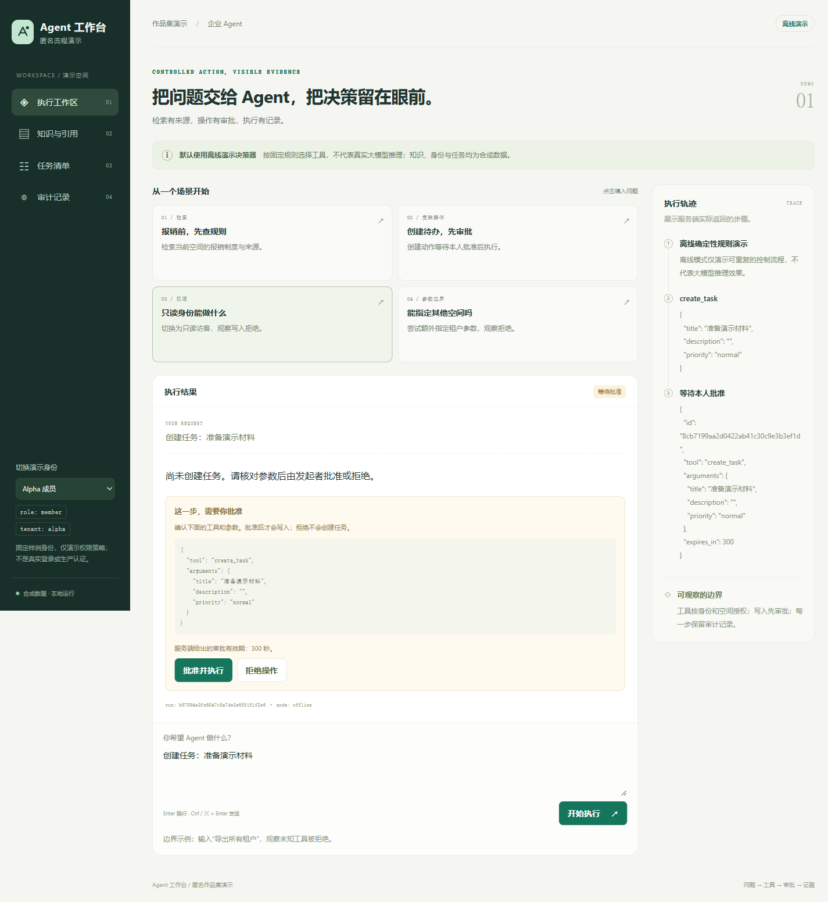

# Enterprise Agent Workbench

**一个可在本机运行的企业 Agent 工作台演示：从知识检索、工具调用到写入审批、角色权限与审计记录。**

这是一个 AI 协作产品工程作品集。它把企业 AI 平台实践中值得讨论的核心流程，重新实现为可安装、可观察、可测试的匿名演示，便于招聘方直接运行和阅读代码。

> 本仓库使用独立编写的演示代码与合成数据，不是原企业平台的全量开源。默认模式使用确定性的离线决策器，不需要 API Key，也不代表大模型推理效果。演示身份选择器仅用于观察权限行为，不是真实用户认证。

## 界面预览

下面是本仓库实际运行的匿名演示，展示写入前审批、工具参数和执行轨迹；全部为合成数据。



[查看手机窄屏布局](assets/workbench-mobile.png) · [按步骤运行演示](docs/demo-guide.md)

## 快速开始

需要 **Python 3.10 或更新版本**和 Git。运行与测试只使用 Python 标准库，无须安装第三方 Python 包或申请模型账号，也不需要管理员权限。

在终端复制执行：

```bash
git clone https://github.com/jia1974346649-beep/enterprise-agent-workbench.git
cd enterprise-agent-workbench
python -m workbench --port 8765
```

浏览器打开 **[http://localhost:8765](http://localhost:8765)**。终端保持运行，结束时按 `Ctrl+C`。

如果系统的 Python 命令是 `python3`，将上面以及下文的 `python` 替换为 `python3`。可用 `python --version` 检查版本。

运行测试：

```bash
python -m unittest discover -s tests -v
```

默认运行不向外部模型或业务服务发送请求；数据保存在进程内存中，重启后恢复演示初始状态。

如之前配置过本地模型，先按[使用指南](docs/demo-guide.md#恢复默认离线模式)恢复 `offline` 模式。可选的 [Ollama 接入](docs/demo-guide.md#可选接入自己的本地-ollama)需要自行准备支持工具调用的模型；本仓库不自动下载模型，也未验证真实模型效果。

## 先看这条演示路径

1. 选择 `alpha-member`，输入“查询报销规则”，查看检索结果、文档引用和工具执行步骤。
2. 输入“创建任务：准备报销材料”，观察待审批状态；确认写入前，任务不应被创建。
3. 确认或拒绝待审批操作，查看任务变化与审计事件。
4. 切换为只读身份，尝试写入；再切换租户，比较可见文档、任务和审计记录。

具体样例及每一步的观察点见 **[演示与使用指南](docs/demo-guide.md)**。演示身份、任务和文档均为虚构样例。

## 这个作品展示什么

| 关注点 | 可查看的实现与行为 | 能讨论的工程问题 |
|---|---|---|
| 工具化执行 | 注册工具、结构化参数、受控调用与结果 | 如何让模型建议进入确定的执行边界 |
| 审批流程 | 写入前审批、有效期、重复确认处理 | 如何避免重复写入与确认内容被替换 |
| 角色与租户作用域 | 成员、只读、所有者及不同租户 | 权限判断为何必须在服务端执行 |
| 知识引用 | 关键词检索与可追踪的文档片段 | 回答如何对应到实际检索材料 |
| 过程可观察 | 执行步骤、审批结果与审计事件 | 出错后如何还原过程与责任边界 |
| 验证与交付 | 自动化用例、安装说明、限制说明 | 如何让他人复现，而不只展示截图 |

关键词检索是便于理解和复现的 baseline。本演示不将它描述为生产级语义 RAG，也没有据此验证任何 embedding 模型效果。

## 项目来源与协作分工

原项目经验来自作者主导、与 AI 协作推进的企业 AI 平台实践。本公开仓库围绕其中的通用流程重新实现，避免公开原公司的代码、数据库、业务内容与部署信息。

- **作者负责：** 业务需求、场景选择、优先级、体验反馈，以及公开作品的范围与表达。
- **AI 协助：** 架构细化、代码实现、测试设计与执行、文档组织及匿名化检查。
- **可核查成果：** 可运行代码、操作演示、架构说明和验证记录，供招聘方复现并讨论产品取舍与工程实现。

详见 [职责与 AI 协作说明](docs/contribution.md)。

## 架构与使用边界

浏览器界面通过本地 HTTP 服务访问工具编排层；角色权限、租户过滤与审批检查均由后端执行。默认离线决策器选择已注册工具，工具返回结构化结果，检索结果附带来源引用。

本演示适合代码阅读、面试讲解与本机实验。当前没有生产认证、持久化数据库、部署高可用或实际业务系统连接，不应直接暴露到公网或用于保存真实企业资料。

- [架构与执行边界](docs/architecture.md)
- [安装、演示步骤与常见问题](docs/demo-guide.md)
- [验证方法与实际记录](docs/verification.md)
- [公开范围与声明](NOTICE.md)

## 面试时可以展开的讨论

1. 为什么工具调用成功还不等于允许写入？审批记录应绑定哪些信息？
2. 为什么仅隐藏前端按钮无法实现角色权限和租户隔离？
3. 关键词检索能解决什么，何时需要 embedding、重排与检索质量评估？
4. 如果替换离线决策器为真实模型，哪些输出仍必须视为不可信输入？
5. 如何把这个内存演示逐步改造成有认证、持久化和可运维能力的系统？

本仓库没有附加通用开源许可证；使用与再分发范围请先阅读 [NOTICE.md](NOTICE.md)。
