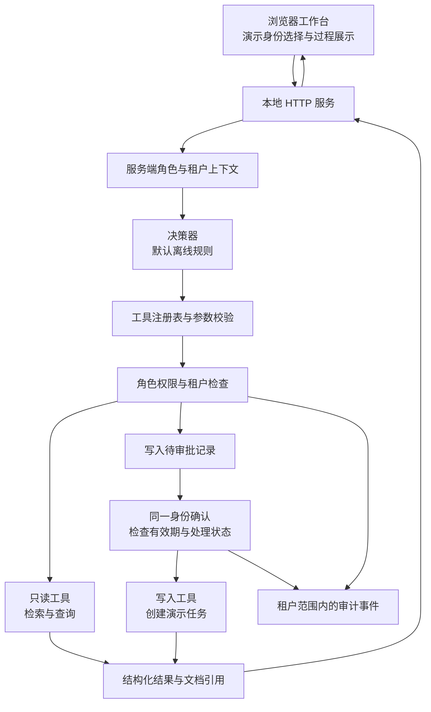

# 架构与执行边界

## 设计目标

以尽量少的运行依赖，演示企业 Agent 中容易被界面掩盖的执行问题：谁提出请求、能调用什么工具、能接触哪个租户的数据、写入前由谁确认，以及发生了什么。

本演示把自然语言入口与业务执行边界分开。默认离线决策器通过确定规则产生工具请求，用于可复现演示；它不模拟已经验证的大模型智能程度。

图中展示逻辑边界，不意味着所有组件都必须拆成独立服务。

## 请求身份与数据作用域

演示预设了两个租户，以及所有者、成员和只读身份。浏览器可通过选择器切换身份；请求用 `X-Demo-Actor` 指定演示身份，后端将其映射为角色与租户上下文。

这只是测试权限行为的入口，不能证明请求者的真实身份。生产系统需要登录认证、会话校验和可信的身份来源，不能允许客户端任意选择角色。

作用域检查应覆盖文档、任务和审计事件。无论请求来自界面、直接 HTTP 调用还是未来的模型输出，都必须经过同样的服务端检查。公开文档不宣称该内存演示已经过生产级安全认证或渗透测试。

审计查询的具体规则是：所有者可查看当前租户的事件；成员与只读身份仅能查看自己的事件，不能借此读取同租户其他身份的操作记录。

## 工具执行

工具由后端预先注册，并声明参数结构与调用条件。决策器只能请求已注册的工具，不能直接执行任意函数名、命令、文件路径或 SQL。

当前演示工具为 `search_knowledge`、`list_tasks` 和 `create_task`，分别负责知识检索、任务查询与任务创建。

每次执行应遵循以下顺序：

1. 解析请求并检查输入大小与结构。
2. 识别当前服务端角色及租户。
3. 校验工具是否注册、参数是否符合约束。
4. 检查调用权限与租户范围。
5. 只读操作返回结果；写入操作先进入审批。
6. 记录执行结果、拒绝或错误，返回可观察的步骤。

前端的禁用按钮与提示只用于辅助操作，不承担最终授权。

## 写入审批

待审批记录在服务端保存，绑定原请求的身份、租户、工具及参数，并有有效期和处理状态。确认请求不应携带可覆盖原记录的任意工具参数。

必须讨论的边界包括：

- 审批人切换为另一个身份或租户时，不能继承该待审批操作。
- 过期后应重新提出请求，不能执行旧操作。
- 拒绝操作后不应写入。
- 重复确认不能产生第二个任务。
- 审批通过时仍应执行必要的服务端校验。

不存在的审批与不属于当前身份的审批统一返回 `404`，避免用不同响应暴露其他身份是否持有某条审批记录。

这里的“审批”是请求者对演示写入的确认，不代表已经实现企业中独立审批人的多级审批制度。

## 可选本地模型

显式设置 `WORKBENCH_MODE=ollama` 并指定已安装模型后，可将离线决策器替换为本机 Ollama 的工具调用协议。默认连接本机服务，不接受任意外部模型地址；启动程序不会自动安装 Ollama 或下载模型。

模型返回的工具名与参数仍进入同一注册、校验、权限及审批链路，不能直接触发任意执行。协议测试与真实模型效果是不同的验证项目；本作品没有据此宣称真实模型任务质量。配置步骤见[使用指南](demo-guide.md#可选接入自己的本地-ollama)。

## 检索与引用

合成文档先按租户过滤，再通过关键词匹配检索。返回结果包含文档标识、标题和片段，界面用这些字段显示可追踪引用。

此方案便于理解检索和引用如何贯穿工具流程，但没有包含完整的文档解析流水线、embedding 索引、向量数据库、重排、召回评测或知识更新任务。因此应称为“带来源引用的关键词检索演示”，不能以此宣称生产级语义 RAG 效果。

## 可观察性与状态

运行结果包含状态、执行步骤、回答、引用及可能存在的审批信息。审计事件按前述租户与身份规则约束访问，用于解释操作经过。

文档、任务、审批与审计状态保存在进程内存中。所有者可重置当前租户的演示状态，重启进程也会恢复初始样例。该机制不具备数据库事务、跨进程共享或持久化审计能力。

## 向真实系统演进时需要补什么

| 演示中的取舍 | 生产系统中需要进一步实现与验证 |
|---|---|
| 固定演示身份选择 | 真实认证、会话与服务端授权上下文 |
| 进程内存状态 | 数据库、迁移、事务、并发及幂等约束 |
| 本地 HTTP 服务 | 受控部署、传输保护、网络访问边界 |
| 关键词检索 | 文档治理、索引与检索质量评估 |
| 确定性离线决策器 | 模型协议、输出校验、预算与任务评测 |
| 当前进程的审计列表 | 持久化留痕、访问控制与留存策略 |

这些是后续设计议题，不是本仓库已经交付的生产能力。
